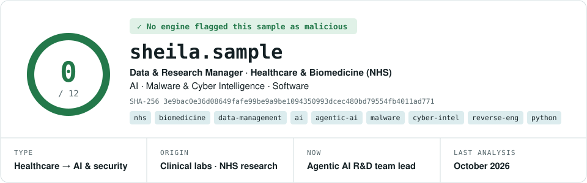
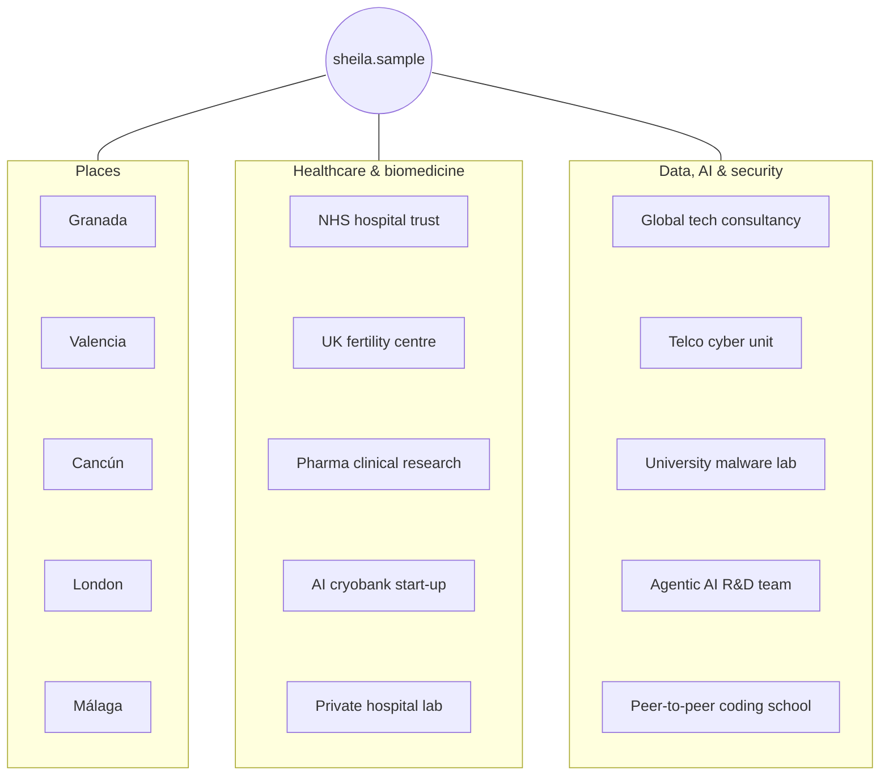

<p align="center">
  <a href="https://sheifc.github.io">
    <picture>
      <source media="(prefers-color-scheme: dark)" srcset="assets/report-header-dark.svg">
      
    </picture>
  </a>
</p>

<p align="center">
  <a href="#-detection"><b>DETECTION</b></a> &nbsp;·&nbsp;
  <a href="#-details"><b>DETAILS</b></a> &nbsp;·&nbsp;
  <a href="#-relations"><b>RELATIONS</b></a> &nbsp;·&nbsp;
  <a href="#-behavior"><b>BEHAVIOR</b></a> &nbsp;·&nbsp;
  <a href="#-strings"><b>STRINGS</b></a> &nbsp;·&nbsp;
  <a href="#-dropped-files"><b>DROPPED FILES</b></a> &nbsp;·&nbsp;
  <a href="#-community"><b>COMMUNITY</b></a>
</p>

<p align="center">
  <a href="https://sheifc.github.io"></a>
  <a href="https://www.linkedin.com/in/sheifc/"></a>
  <a href="https://tryhackme.com/p/stylishack"></a>
  
  
  
</p>

```console
$ analyze sheila.sample
[+] verdict ...... clean · 0/12 engines flagged this sample
[+] profile ...... data & research manager from healthcare and biomedicine (NHS)
[+] payload ...... AI · malware analysis · cyber intelligence · software
[+] now .......... leading an R&D team building agentic AI for cybersecurity
[+] behaviour .... turns regulated data into decisions, and malware into intelligence
```

## 🧪 Detection

> Engine verdicts: everyone who has examined this sample so far.

| Engine | Verdict | | Engine | Verdict |
|:--|:--|:-:|:--|:--|
| HFEA Inspection | ✅ Compliant | | ISO 9001 Auditor | ✅ Certified the lab |
| NHS Clinical Team | ✅ AI adopted | | Pre-launch AI Audit | ✅ UK first, audited |
| UK Fertility Rankings | ✅ 20th → 4th | | NLP Model Validation | ✅ 95% accuracy |
| L1 Analysts & QA | ✅ Escalations closed | | Anti-fraud Unit | ✅ Threats neutralised |
| Univ. of Valencia MSc | ✅ 9.92 / 10 | | Univ. of Barcelona MSc | ✅ 9.29 / 10 |
| Univ. of Málaga RE & Malware | ✅ 9.5 / 10 | | 42 Málaga Peer Review | ✅ 125 / 100 |

## 🧬 Details

<table>
  <tr><td><code>Names</code></td><td>sheila.sample · Sheifc · stylishack</td></tr>
  <tr><td><code>Current build</code></td><td><b>R&D Team Lead · Agentic AI for Cybersecurity</b></td></tr>
  <tr><td><code>Profile</code></td><td><b>Data & Research Manager</b> · Healthcare & Biomedicine · <b>NHS</b> · AI · Malware & <b>Cyber Intelligence</b> · Software</td></tr>
  <tr><td><code>Registration</code></td><td>HCPC-registered Clinical Scientist (UK)</td></tr>
  <tr><td><code>Locales</code></td><td>es (native) · en (C1)</td></tr>
</table>

**Sections**

| Section | Status | Contents |
|:--|:--|:--|
| `.health` | `persistent` | 10+ years in **clinical labs and biomedical research** (NHS UK, Spain, Mexico) · clinical research with pharma · lab director |
| `.research` | `always on` | **Research data management** · large clinical datasets · biostatistics · ML on medical imaging · DICOM · GDPR anonymisation |
| `.qa` | `always on` | **HFEA** audits · **ISO 9001** certification · **ISO 15189** risk assessment · co-author of a national ethics code (ASEBIR) |
| `.data` | `running` | **ML pipelines** in AWS · Terraform · **NLP / Transformers** · Power BI · data quality & BI |
| `.sec` | `active` | **Malware analysis & reverse engineering** (Android, L2) · **threat & cyber intelligence** · detection engineering · SOC |
| `.ai` | `executing` | **LLMs & agentic AI** for cybersecurity · AI adoption in regulated environments · team leadership |

## 🕸️ Relations

> Places and kinds of teams this sample has connected to.



## 🧫 Behavior

> Sandbox activity: the story, as the sandbox logged it.

| Operation | Detail |
|:--|:--|
| `InitBiology` | BSc Biology (Granada) and a first research project at an international congress |
| `SpecialiseIVF` | MSc Biotechnology of Assisted Human Reproduction (9.92/10) |
| `ClinicalPractice` | Clinical embryology and research in Spain and Mexico, including pharma clinical research |
| `RelocateUK` | Moves to the UK; laboratory analyst across chemistry and microbiology labs |
| `DataAnalysis` | Integrates machine learning with time-lapse imaging; the centre rises from 20th to 4th in the UK |
| `DeployAI` | Leads the roll-out of AI software in **NHS** clinical workflows; builds an HFEA-standard cryobank system |
| `AuditCryobank` | Pre-launch audit of the UK's first AI-driven cryobank |
| `CertifyISO9001` | Laboratory director; leads ISO 9001 certification |
| `BuildPipelines` | MSc Data Science, then ML pipelines in AWS and BI dashboards |
| `Inject` | Joins cybersecurity: SOC, detection engineering and SOAR |
| `Hunt` | Phishing and fraud detection and response |
| `Reverse` | Level 2 Android malware analyst for a confidential Tier-1 client |
| **`Spawn`** | **Leads an R&D team building agentic AI for cybersecurity** |

**Capabilities observed:** `research data management` `clinical research` `AI adoption` `LLMs` `agentic AI` `malware analysis` `reverse engineering` `cyber intelligence` `threat hunting` `detection engineering` `ML pipelines` `regulatory audits` `team leadership` `mentoring`

## 🔤 Strings

```console
$ strings -n 4 sheila.sample | sort -u
[malware]   IDA Pro · Ghidra · Radare2 · x86 assembly · Frida · CAPE · Cuckoo · Any.Run
            Procmon · Process Explorer · PEStudio · PEframe · PortEx · CFF Explorer
            010 Editor · Scylla · VirusTotal · Google Threat Intelligence
[intel/soc] MISP · YARA · Sigma · SIEM · EDR · SOAR · Maltego · Wireshark · Nmap · Metasploit
[ai/data]   Python · pandas · NumPy · scikit-learn · TensorFlow/Keras · Transformers
            LLMs · AI agents · OpenCV · SQL · R · Power BI
[cloud]     AWS (S3, Lambda, Redshift) · Google Cloud · Terraform · Docker · Git · Jira
[health]    NHS · HFEA · ISO 9001 · ISO 15189 · GDPR · DICOM · biostatistics
[code]      C · C++ · Python · Bash · R · SQL
[motto]     every sample must be traceable
```


## 📦 Dropped files

> Repositories and artefacts produced by this sample.

| File | Contents |
|:--|:--|
| 📁 [`TryHackMe/`](https://github.com/Sheifc/TryHackMe) | Offensive and defensive lab write-ups |
| 📁 [`Cybersecurity/`](https://github.com/Sheifc/Cybersecurity) | SOC training: [Windows](https://github.com/Sheifc/Cybersecurity/tree/main/Windows) · [Linux](https://github.com/Sheifc/Cybersecurity/tree/main/Linux) · [Network/Cisco](https://github.com/Sheifc/Cybersecurity/tree/main/Networking-Cisco) · [Wireshark](https://github.com/Sheifc/Cybersecurity/tree/main/Wireshark) · [Bandit](https://github.com/Sheifc/Cybersecurity/blob/main/Bandit.pdf) · [Cloud](https://github.com/Sheifc/Cybersecurity/tree/main/Cloud) · [SOC tools](https://github.com/Sheifc/Cybersecurity/tree/main/SOC-Tools) |
| 📁 [`42cursus/`](https://github.com/Sheifc/42cursus/tree/main) | Software engineering at 42 Málaga in C and C++ (20 projects, see below) |
| 📁 [`Bioinformatics-and-Biostatistic-Master/`](https://github.com/Sheifc/Bioinformatics-and-Biostatistic-Master) | MSc Data Science coursework: bioinformatics and biostatistics |

<details>
<summary>🏅 <b>TryHackMe badges</b> (expand)</summary>
<br>
<p>
  
  
  
  
  
  
  
  
  
  
  
  
  
  
  
</p>

[Pentesting](https://tryhackme.com/stylishack/badges/intro-to-pentesting) · [Metasploit](https://tryhackme.com/stylishack/badges/metasploitable) · [Network](https://tryhackme.com/stylishack/badges/network-fundamentals) · [OSINT](https://tryhackme.com/stylishack/badges/ohsint) · [OWASP](https://tryhackme.com/stylishack/badges/owasp-10) · [Web](https://tryhackme.com/stylishack/badges/web-fund) · [Web Hacking](https://tryhackme.com/stylishack/badges/intro-to-web-hacking) · [BurpSuite](https://tryhackme.com/stylishack/badges/burped) · [World Wide Web](https://tryhackme.com/stylishack/badges/world-wide-web) · [Linux](https://tryhackme.com/stylishack/badges/terminaled) · [Friday Fixer](https://tryhackme.com/stylishack/badges/friday-fixer) · [Mr. Robot](https://tryhackme.com/stylishack/badges/mr-robot)
</details>

<details>
<summary>💻 <b>42 Málaga projects</b> (expand)</summary>
<br>

| Project | Description | Level | Grade | Bonus |
|:--|:--|:-:|:-:|:-:|
| [Libft](https://github.com/Sheifc/42cursus/tree/main/libft) ✅ | Library of 43 system functions in C | 0 | 125/100 | ✅ |
| [Printf](https://github.com/Sheifc/42cursus/tree/main/printf) ✅ | printf with variadic arguments in C | 1 | 100/100 | – |
| [Get next line](https://github.com/Sheifc/42cursus/tree/main/GNL) ✅ | Memory management with static variables in C | 1 | 125/100 | ✅ |
| [Born2beroot](https://github.com/Sheifc/42cursus/tree/main/Born2beroot) ✅ | System administration, virtualisation and encryption | 1 | 125/100 | ✅ |
| [Exam Rank 2](https://github.com/Sheifc/42cursus/tree/main/Rank2_Exam) ✅ | 57 functions and programs in C | 0–2 | 100/100 | – |
| [Push Swap](https://github.com/Sheifc/42cursus/tree/main/push_swap) ✅ | Sorting algorithm with stacks in C | 2 | 125/100 | ✅ |
| [Pipex](https://github.com/Sheifc/42cursus/tree/main/pipex) ✅ | Redirections, pipes and processes in C | 2 | 125/100 | ✅ |
| [So long](https://github.com/Sheifc/42cursus/tree/main/so_long) ✅ | 2D game in C | 2 | 100/100 | – |
| [Philosophers](https://github.com/Sheifc/42cursus/tree/main/philo) ✅ | Threads and mutexes in C | 3 | 100/100 | – |
| Exam Rank 3 ✅ | printf or get_next_line in C | 1–2 | 100/100 | – |
| [Minishell](https://github.com/Sheifc/minishell) ✅ | A bash-like shell in C, in a pair | 3 | 125/100 | ✅ |
| Netpractice ✅ | Fixing networks between hosts, routers and switches | 4 | 100/100 | – |
| Exam Rank 4 ✅ | Microshell in C | 4 | 100/100 | – |
| [Cub3d](https://github.com/cadufrederiksen/Cub3d) ✅ | 3D raycasting game in C | 4 | 100/100 | – |
| [C++](https://github.com/Sheifc/Cpp) ✅ | C++ modules | 4 | 100/100 | some ✅ |
| Exam Rank 5 ✅ | C++ | 5 | 100/100 | – |
| [IRC](https://github.com/Sheifc/IRC) ✅ | IRC server in C++, in a team | 5 | 125/100 | ✅ |
| [Inception](https://github.com/Sheifc/Inception5.0) ✅ | System administration with Docker | 5 | 125/100 | ✅ |
| Exam Rank 6 ✅ | IRC in C++ | 6 | 100/100 | – |
| Transcendence ✅ | Film review web app | 6 | 120/100 | ✅ |

<p>
  <a href="https://github.com/oakoudad/badge42"></a>
</p>

</details>

<details>
<summary>🎓 <b>Education & certifications</b> (expand)</summary>
<br>

| Qualification | Institution |
|:--|:--|
| **Postgraduate Expert, Reverse Engineering & Malware Intelligence** (9.5/10) | University of Málaga, with Google, VirusTotal & NICS Lab |
| **MSc Data Science: Bioinformatics & Biostatistics** (9.29/10) | Universitat de Barcelona & UOC |
| **MSc Bioethics, Quality & Safety in Healthcare** | University of Valencia |
| **MSc Biotechnology of Assisted Human Reproduction** (9.92/10) | University of Valencia / IVI |
| **BSc Biology** · **BSc Food Science & Technology** | University of Granada |
| **eJPT** · Junior Penetration Tester | INE Security |
| **Data Science Bootcamp** | [Codespace Academy](https://codespaceacademy.com/curso/work-camp-data-science/) |
| **Google IT Automation with Python** · **Google IT Support** | Professional certificates |
| **HCPC-registered Clinical Scientist** | Health and Care Professions Council, UK |
</details>

## 💬 Community

> Comment from the author: this sample is open to new environments in **data & research management**, **healthcare AI** and **cybersecurity**. It runs best where rigour matters: regulated data, real threats, and teams that ship.

<p align="center">
  🌐 <a href="https://sheifc.github.io"><b>sheifc.github.io</b></a> &nbsp;·&nbsp; 💼 <a href="https://www.linkedin.com/in/sheifc/"><b>LinkedIn</b></a> &nbsp;·&nbsp; 🛡️ <a href="https://tryhackme.com/p/stylishack"><b>TryHackMe</b></a>
</p>

<p align="center"><sub>A profile in the shape of a malware analysis report. No samples were harmed.</sub></p>
