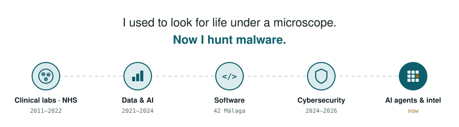

  <picture>
    <source media="(prefers-color-scheme: dark)" srcset="assets/timeline-header-dark.svg">
    
  </picture>

  Hi, I'm <b>Sheila</b> 👋 · data & research manager from <b>healthcare (NHS)</b>, now in <b>AI for cybersecurity</b>, <b>malware analysis</b> and <b>cyber intelligence</b>.

  
  
  
  
  
  

## 🔬 Building now

<table>
  <tr>
    <td width="50%" valign="top">
       
      <h3>📱 <b>Automated mobile app analysis</b></h3>
      From suspicious app to analyst-ready findings, automatically.  
      <code>Android</code> <code>automation</code>
        
    </td>
    <td width="50%" valign="top">
       
      <h3>🕵️ <b>Dark-web forum monitoring</b></h3>
      An app to monitor intelligence forums on the dark web.  
      <code>CTI</code> <code>OSINT</code>
        
    </td>
  </tr>
  <tr>
    <td colspan="2" valign="top">
       
      🎤 <a href="https://github.com/Sheifc/level-up-copilot-security"><b>level-up-copilot-security</b></a> · talk on AI coding assistants for secure code (OWASP Top 10)
        
    </td>
  </tr>
</table>

## 🧭 How I got here

<table>
  <tr><td>🧫 <b>The lab</b></td><td>2011–2022</td><td>NHS AI roll-out · HFEA &amp; ISO 9001 audits · biomedical research</td></tr>
  <tr><td>📊 <b>The data</b></td><td>2021–2024</td><td><a href="https://github.com/Sheifc/Bioinformatics-and-Biostatistics-Master">Bioinformatics MSc</a> · <a href="https://github.com/Sheifc/KNN-Algorithm-applied-to-Promotor-Sequences-of-E.Coli">KNN on E. coli DNA</a> · <a href="https://github.com/Sheifc/Natural-Language-Processing">NLP</a></td></tr>
  <tr><td>💻 <b>The code</b></td><td>42 Málaga</td><td><a href="https://github.com/Sheifc/42cursus">42cursus</a> · <a href="https://github.com/Sheifc/minishell">minishell</a> · <a href="https://github.com/Sheifc/IRC">IRC</a> · <a href="https://github.com/Sheifc/Inception5.0">Inception</a> · <a href="https://github.com/Sheifc/42-C-piscine">C piscine ⭐</a> · <a href="https://github.com/Sheifc/AI-league-42-Malaga">AI League</a></td></tr>
  <tr><td>🛡️ <b>The threats</b></td><td>2024–2026</td><td>Android malware RE · <a href="https://github.com/Sheifc/Cybersecurity">Cybersecurity</a> · <a href="https://github.com/Sheifc/TryHackMe">TryHackMe</a> · <a href="https://github.com/Sheifc/Networking-Cisco">Networking</a></td></tr>
  <tr><td>🤖 <b>The agents</b></td><td>now</td><td>Leading an R&amp;D team building agentic AI for cybersecurity</td></tr>
</table>

## 🧰 Toolbox

  

IDA Pro · Ghidra · jadx · Frida · YARA · MISP · LLMs · AI agents · Vertex AI
